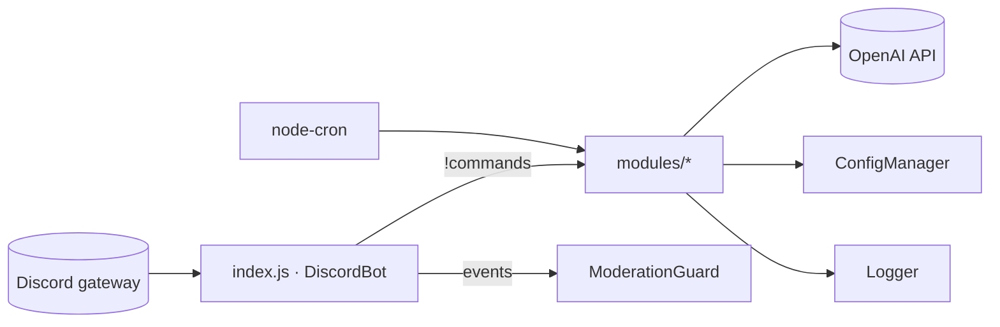

# Architecture

## Stack

- Node.js with ESM (`"type": "module"`) and plain JavaScript, no build and no TypeScript
- `discord.js` for the gateway, the messages and the buttons
- `openai` SDK for summaries and random interventions (`gpt-4o-mini`)
- `node-cron` for the nightly purge and the salary reminders
- `dotenv` for secrets and Discord IDs

## How it fits together

## Key decisions

- One class per feature in `src/modules/`. Each takes `(client, guild)` and is instantiated in `DiscordBot.initializeModules()`.
- Commands are prefix commands (`!`), routed by a `switch` in `index.js#handleCommand`. There are no slash commands.
- `src/config.json` holds behaviour and prompts. Every Discord ID is `"FROM_ENV"` and is overridden in `ConfigManager` from `.env`.
- Read config through `config.get('a.b')`, which returns `undefined` on a missing path and never throws.
- Single guild only: `GUILD_ID` is required, and messages from other guilds are ignored.
- Most state lives in memory (`Map`s, `setTimeout`): active votes, roulette punishments, summary counters. A restart loses all of it. Only salaries persist, in `src/data/salaries.json`.

## Gotchas

- `config.json` lives at `src/config.json`, not at the repo root as the README says.
- The `EXILES_ROLE_ID` env var also overwrites `roles.moderatorRoles`, so every Exilé counts as a moderator.
- `index.js#onReady` checks `this.logTalkId`, which is never set, so Discord logging is effectively off.
- In the `handleCommand` switch, `list_salaries` has no `break` and falls through into roulette.
- `showConfig` reads `summary.enabled` and `summary.scheduledTimes`, but neither key exists in the config.
- `SummaryManager.generateScheduledSummaries` exists, but nothing schedules it.
- A message starting with `!` is treated as a command, and the summary collector ignores it as well.
- The DM `!prompt` command is gated by a user ID hardcoded in `index.js`.
