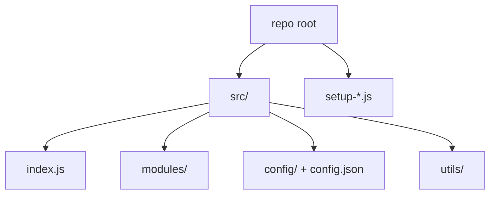

# Codebase Map

## Areas

- `src/index.js`: the `DiscordBot` class, event wiring, command routing, `!help`, `!status`, `!config`, and the DM `!prompt`
- `src/modules/`: one class per feature (`SummaryManager`, `VoteSystem`, `ModerationGuard`, `RouletteRusse`, `RandomIntervention`, `SalaryChecker`, `Scheduler`, `ValidationSystem`)
- `src/config/ConfigManager.js` + `src/config.json`: config loading and env overrides, exported as a singleton
- `src/utils/Logger.js`: a singleton that writes to the console, to `logs/` files and to a Discord channel
- `setup-roles.js`, `setup-channels.js`: one-off scripts that create the server roles and channels

## Entry points

- `src/index.js` (`npm start`, `npm run dev` with `--watch`)
