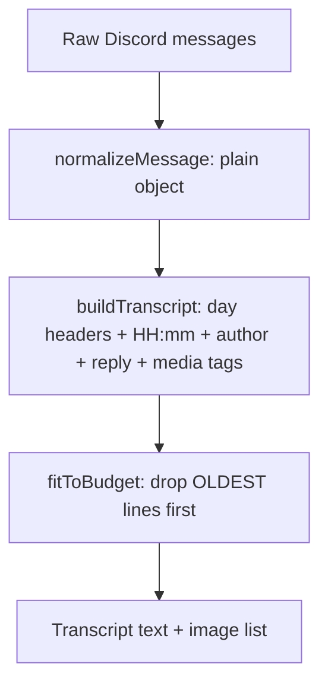
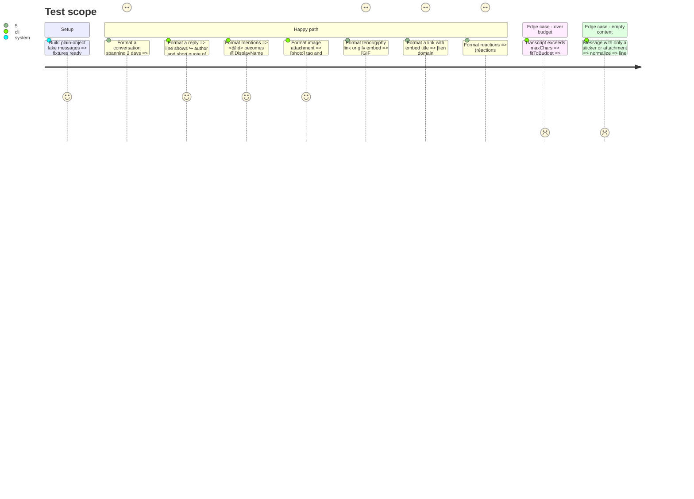

# Instruction: Transcript builder

## Architecture projection

```txt
.
├── package.json                          ✏️ "test": "node --test"
├── src/modules/summary/transcript.js     ✅ pure functions, no discord.js / openai import
└── test/transcript.test.js               ✅ node:test unit tests
```

## User Journey



## Test Scope



## Tasks to do

### `1)` Normalize a Discord message

> Convert a discord.js `Message` to a plain object that the formatter can consume, so the formatter never touches discord.js.

1. `normalizeMessage(msg, resolveName)` returns `{ id, authorName (member displayName ?? globalName ?? username), isBot, content, createdAt, replyToId, attachments:[{url,name,contentType}], embeds:[{type,url,title,description,provider,thumbnailUrl}], stickers:[name], reactions:[{emoji,count}], edited }`.
2. Replace `<@id>`/`<@!id>` mentions with `@` + `resolveName(id)`, `<#id>` with `#channel-name` (via resolver), `<@&id>` with `@role`, and custom emoji `<a?:name:id>` with `:name:`.

### `2)` Build the transcript

> Produce a readable chronological transcript that the model can follow.

1. `buildTranscript(messages, { timeZone: 'Europe/Paris', byId })`: messages arrive in chronological order. Emit a `--- <weekday dd/mm> ---` header when the day changes.
2. Line format: `[HH:mm] Author: content`, plus `↪ à Author « first 60 chars »` when the message is a reply and the parent is known (via `byId`), else `↪ (réponse à un message plus ancien)`.
3. Media tags: image → `[photo]`; video → `[vidéo]`; other file → `[fichier: name]`; `.gif`, tenor, giphy or a `gifv` embed → `[GIF: <slug words or title>]`; other URL → `[lien <domain>: <embed title if any>]`; sticker → `[sticker: name]`; reactions → `(réactions: 😂x3 💀x2)`; edited → `(modifié)`.
4. Collect the images for vision: image attachments, plus GIF thumbnails whose URL is png, jpg or webp. Each one is `{ url, ref: "img N" }`, and its line is tagged `[photo img N]` / `[GIF img N: ...]`. Keep the most recent N images only (N = parameter).
5. Merge consecutive messages from the same author less than 2 minutes apart into one line separated by ` / `, to save tokens.

### `3)` Fit to budget

> Never cut the most recent messages.

1. `fitToBudget(lines, maxChars)` drops the oldest lines until the result fits, then prepends `[... N messages plus anciens omis ...]`.

### `4)` Tests

1. Add `test/transcript.test.js` that covers every journey row above. Set `"test": "node --test"` in package.json.

## Test acceptance criteria

| Task | Acceptance criteria |
| ---- | ------------------- |
| 1 | A fake message with mentions, reply, attachments and embeds yields the full plain object, with names resolved |
| 2 | The transcript shows day headers, local times, reply context and every media tag, and caps the vision images at N |
| 3 | Over budget, the last message is always present and the first line is the omission marker |
| 4 | `npm test` passes with no network and no `node_modules` beyond the existing ones |
