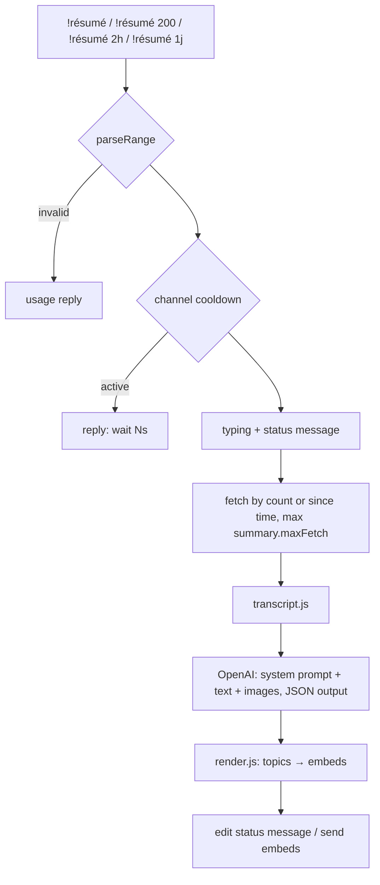

# Instruction: Summary command rewrite

## Architecture projection

```txt
.
├── src/config.json                         ✏️ summary + ai keys, new prompt
├── src/modules/SummaryManager.js           ✏️ range, fetch, vision call, render, cooldown
├── src/modules/summary/range.js            ✅ parseRange(args) pure
├── src/modules/summary/render.js           ✅ parse model JSON → embed payloads, split under Discord limits
├── test/range.test.js                      ✅
└── test/render.test.js                     ✅
```

## User Journey



## Test Scope

```mermaid
---
title: Test scope
---
journey
  section Setup
    Fake model JSON and arg arrays => fixtures ready: 5: system
  section Happy path
    parseRange([]) => count = summary.maxMessages: 5: cli
    parseRange(["2h"]) => since = now-2h: 5: cli
    parseRange(["150"]) => count 150: 5: cli
    renderSummary(json) => one embed with TL;DR then topic fields, each under limits: 5: cli
  section Edge case - bad args
    parseRange(["abc"]) => error with usage text: 1: cli
    parseRange(["3j"]) above max window => clamped to summary.maxHours: 1: cli
  section Edge case - long output
    renderSummary with many topics => split across several embeds/messages, nothing silently cut: 1: cli
  section Edge case - model returns non-JSON
    renderSummary(plain text) => falls back to plain description chunks: 1: cli
```

## Tasks to do

### `1)` Range parsing

> Make the command easy to use: by number of messages or by duration.

1. `parseRange(args, { defaultCount, maxCount, maxHours, now })` accepts `N` (from 10 to maxCount), `Nm`, `Nh`, `Nj`/`Nd`. It returns `{ mode:'count', count }` or `{ mode:'since', since:Date, label }`, or `{ error }`.
2. Use `defaultCount` 100, `maxCount` 1000 and `maxHours` 48, all from config.

### `2)` Collection

> Fetch the right window without dropping context.

1. Fetch in batches of 100 with `before`, and stop on the count, on `createdAt < since`, or on `summary.maxFetch`.
2. Keep short messages. Drop only empty messages with nothing attached, `!` commands, and this bot's own messages. When `summary.excludeBotMessages` is set, drop other bots as well.
3. Prefetch the replied-to parents that are outside the window, at most 20 `channel.messages.fetch(id)` calls in parallel, and tolerate failures.
4. Build the transcript through `transcript.js`, using `summary.maxInputChars` and `summary.maxImages`.

### `3)` AI call

> Accurate content, sarcasm-aware, structured output.

1. Send the user content as an array: a text part (transcript) plus `image_url` parts with `detail: "low"` for the collected images.
2. Use `response_format: { type: "json_object" }`, `temperature` from config, and `max_tokens` from `ai.maxTokensOutput`, set to 1200.
3. New `ai.systemPrompt` in French with a casual tone. The model:
   - groups the conversation by topics, at most `summary.maxTopics` (6);
   - gives each topic a title, the main people and 1-3 short sentences: who said what, what was decided, what is funny;
   - reads sarcasm, irony and second-degree jokes for their real meaning, using the reactions and emojis as cues;
   - describes what the photos and GIFs show or mean when it matters;
   - mentions times only when they matter ("vers 23h");
   - never invents anything, and uses the display names exactly as written.
4. The model answers with `{ "tldr": string, "topics": [{ "title", "emoji", "people": [string], "summary" }], "vibe": string }`.

### `4)` Render and send

> Readable output, never silently truncated.

1. `renderSummary(json, meta)`: the embed title is `Résumé #channel · <label>`. The description holds the **TL;DR** and the vibe line, with one field per topic (`emoji title`, value = summary + `— people`). The footer shows the message count and the period (HH:mm → HH:mm).
2. Respect the limits: field value ≤ 1024, description ≤ 4096, ≤ 25 fields, ≤ 6000 chars per embed. Overflow goes to the next embed or message.
3. Fallback: if the JSON parse fails, split the raw text into ≤ 4000-char description chunks.
4. Send to the configured `summaryChannelId` if valid, else to the current channel. Edit the status message into "Résumé prêt" or delete it.

### `5)` Guardrails and cleanup

1. Set a cooldown per channel (`summary.cooldownSeconds`, 60). Reject a concurrent run on the same channel.
2. Call `channel.sendTyping()` while the summary is generated.
3. Remove the dead `generateScheduledSummaries` and the unused `recentSummaries` and `member` variables. Keep `checkAutoTrigger` working with the new pipeline (the threshold is 0, so it is off by default).
4. Update `!help` and the README summary section with the new syntax.

## Test acceptance criteria

| Task | Acceptance criteria |
| ---- | ------------------- |
| 1 | Counts, minutes, hours and days parse. Invalid input returns a usage error. Out-of-range values are clamped. |
| 2 | `!résumé 2h` stops fetching at the first message older than 2h. Short messages like "mdr" stay in the transcript. |
| 3 | The request carries the transcript and at most `maxImages` image parts, with `json_object` format |
| 4 | The output is topic-based, and every embed is within the Discord limits. A long output spans several embeds instead of being cut. |
| 5 | A second `!résumé` in the same channel within the cooldown gets a wait reply. `npm test` passes. |
