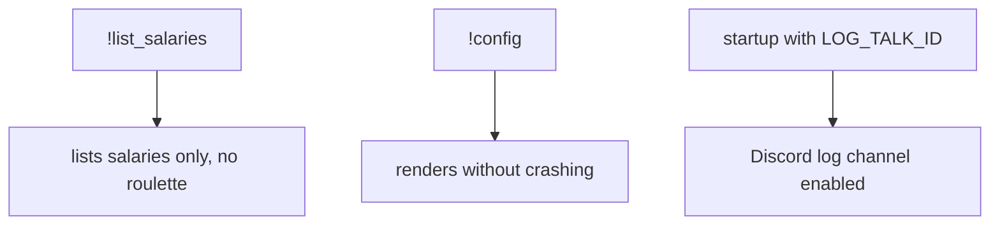
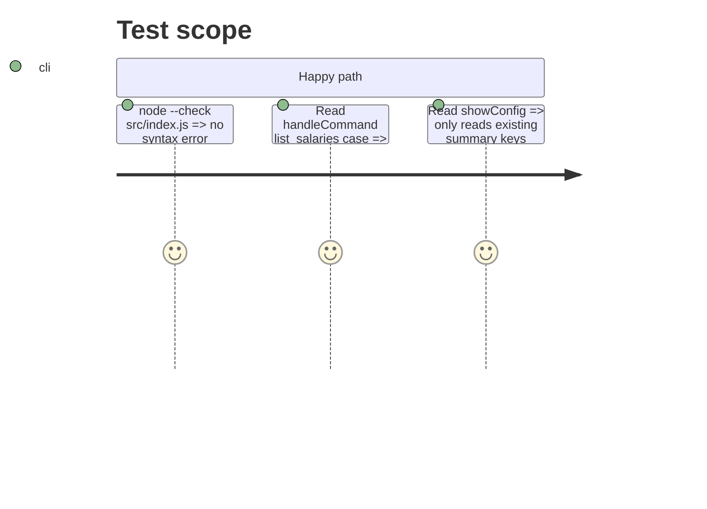

# Instruction: Project bug fixes from review

## Architecture projection

```txt
.
├── src/index.js       ✏️ break after list_salaries, logTalkId bug, showConfig, !status
└── README.md          ✏️ config path is src/config.json
```

## User Journey



## Test Scope



## Tasks to do

### `1)` Command fallthrough

1. Add the missing `break` after the `list_salaries` case in `handleCommand`.

### `2)` Log channel

1. In `onReady`, use `this.logChannel` (the fetched channel) in place of the never-set `this.logTalkId` when calling `logger.setLogChannel` and logging its name.

### `3)` `!config` and `!status`

1. `showConfig` shows `maxMessages`, `cooldownSeconds`, `maxImages` and `autoTriggerThreshold`, and no longer reads `summary.enabled` or `summary.scheduledTimes`.
2. `showStatus` lists each module with ✅ or ❌, depending on whether it was initialized.

### `4)` Docs

1. README: point to `src/config.json` and document the new `!résumé` syntax.

## Test acceptance criteria

| Task | Acceptance criteria |
| ---- | ------------------- |
| 1 | `!list_salaries` no longer triggers a roulette |
| 2 | With a valid `LOG_TALK_ID`, Discord logging is enabled at startup |
| 3 | `!config` renders without `TypeError`. `!status` reflects the real state of each module. |
| 4 | The README matches the code |
